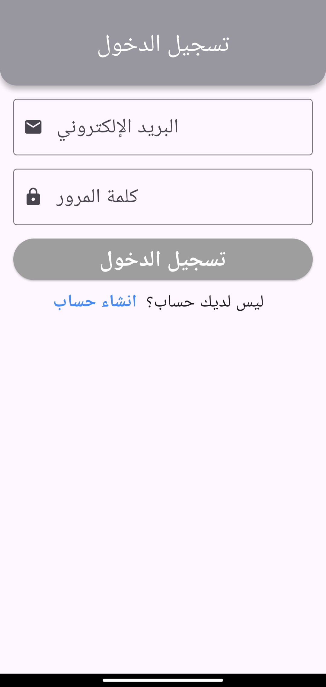
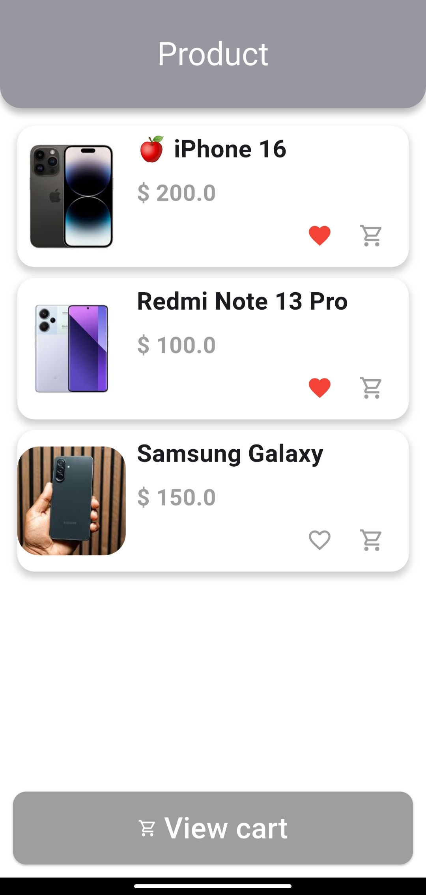
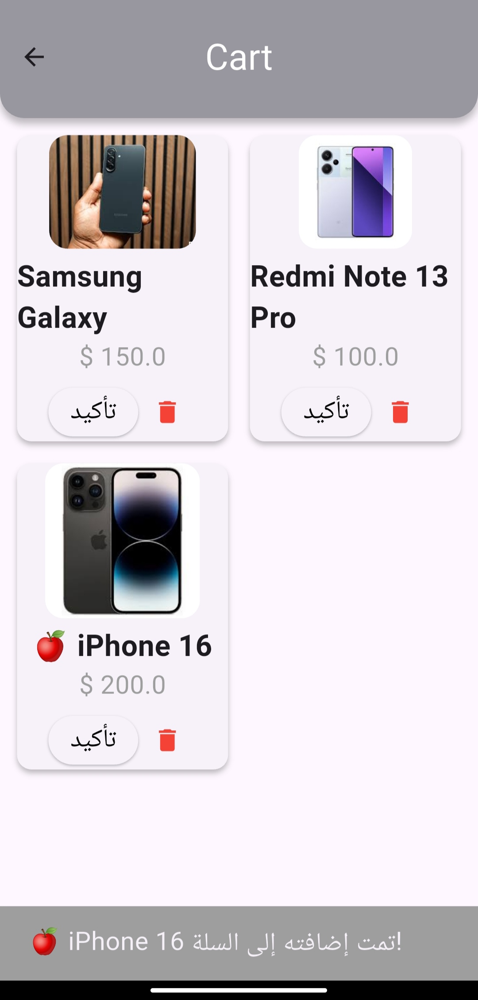

# Mobile Store UI

A Flutter UI prototype for a mobile phone shopping application.

## About

Mobile Store is a simple shopping application UI built with Flutter and Dart.

The application provides a basic shopping experience where users can browse mobile phones, view product details, add products to a shopping cart, and manage cart items.

This project focuses on UI design, screen navigation, and basic user interactions. It does not include a real authentication system, backend integration, or actual payment processing.

## Features
- Login and Registration screens.
- Responsive layouts for different screen sizes.
- Display mobile phone products.
- View product details.
- Add products to the shopping cart.
- View cart items.
- Remove products from the cart.
- Purchase confirmation interface.

## Screenshots

### Login Screen

### Product Listing

### Shopping Cart

## Technologies Used
- Flutter
- Dart
- Material Design

## Project Structure

myapplogin/
├── lib/
│   └── ...
├── screenshots/
│   ├── login_01.jpg
│   ├── ProductPhone_02.jpg
│   └── cardPhone_03.jpg
├── android/
├── ios/
├── pubspec.yaml
└── README.md

## Project Status
UI Prototype – Frontend Only.

This project was created for practicing Flutter UI development and building responsive mobile application interfaces.